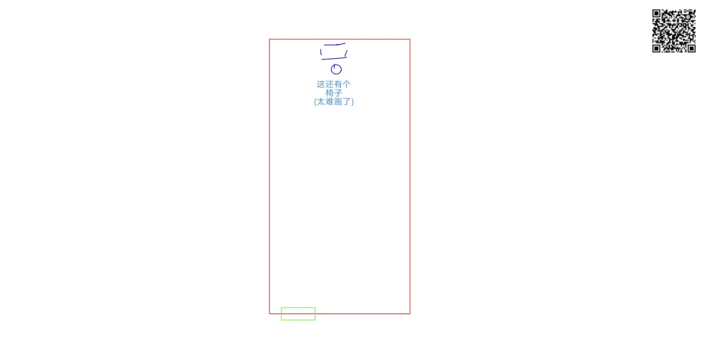
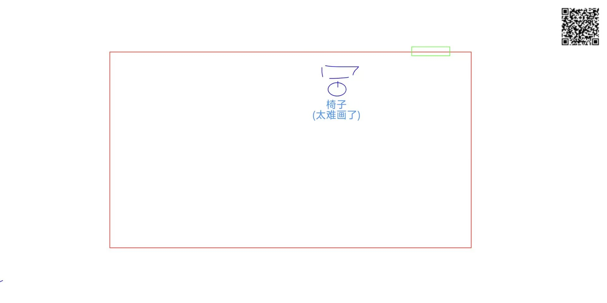
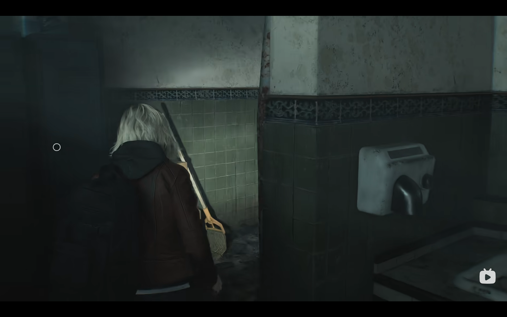
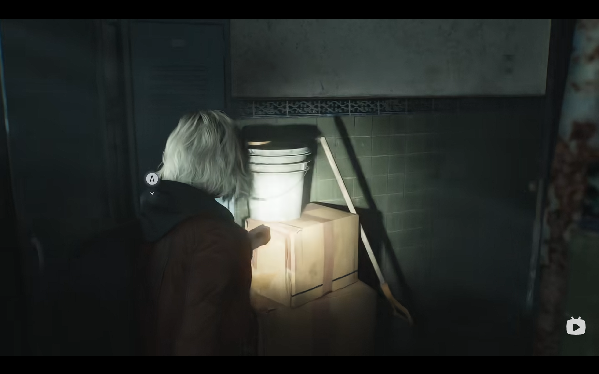
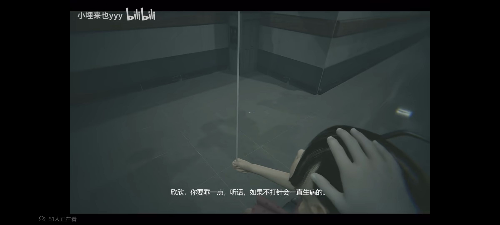

# 总策划案

# 标题（待定）

# 剧情设定

## 初案

简介:简而言之这是一个有科技元素的有点受温子仁影响的恐怖故事，而且又套了一层meta，通过让人玩游戏以及存存档和删存档的方式来进行夺舍（无论是玩游戏还是处理存档，尤其是最终的删存档步骤都是要按键的），底子可以看作那种有个倒霉鬼被小人里寄宿的灵魂夺舍，自己被困在了小人里，只不过这次是游戏而已。

剧情架构：

- 游戏（里）
- 游戏（表）

  - 剧情（里）
  - 剧情（表）

剧情（表）：（背景设定在美国吧）主角是一个假期在家的青年，是一名恐怖游戏爱好者，父母因事出差，而他则在玩刚收到的朋友匿名送给他的礼物——一个新恐怖游戏卡带，里面大致讲述了一个青年的死亡。

主角在游玩过程中逐渐感到游戏的诡异，比如明明是用自己的电脑下载却自带一个旧存档且无法删除，游戏的主角也时不时如同有生命般做出异常meta举动，自己越玩越觉得疲惫，且家里不断出现灵异事件，再加上游戏的诡异，他愈发觉得这些和游戏有关联。

于是他上网搜索这个游戏的相关信息，却发现根本不存在这款游戏。于是他发帖子求助，只有一个以前接触过某种巫术的人说觉得熟悉。对方表明存在这么一类巫术，能把冤魂寄宿在书籍里，随着信息的摄入，冤魂就会出现在现实中不断干扰受害者的现实生活，甚至加害于他，只有读完信息体会了冤魂的痛苦，并随后剔除掉书上的契印，冤魂才能被超度。

对方认为主角现在正在玩的游戏是这种巫术的现代变体，恐怕必须要玩完游戏全程，并删除掉旧存档，才能超度冤魂。并教授了他一些**对付冤魂的方法**，比如用银弹攻击冤魂，用符咒阻隔冤魂。主角尝试后发现果然可行，于是展开了加速玩完游戏并对抗冤魂的流程。从最开始层层恐惧式的场景惊吓，被动躲避，到后来找到对抗方法的显形追逐战，关门隔绝，利用道具隔离来转移阵地（恐怖玩法），等等，最终终于顺利玩完了游戏，并听着拍门声与一阵阵怒吼删掉了旧存档。

可删除的一瞬间，一些记忆涌入了他的脑海，是他曾以为的冤魂追逐阻挠他的视角，原来夺舍仪式的真正运作方式是他存入自己的存档，并删除旧存档解放寄宿在游戏中的灵魂夺取他的身体。那个所谓的“冤魂”是他分出去的一部分灵魂，由于只有一小部分，且始终被恐惧与急躁包围，分出去的游魂只能靠着直觉行动，没法做出复杂的思考，想要回归本体以及阻止本体玩完游戏删除旧存档，最后也是在拍着门呐喊让自己不要删除旧存档，却被本体阻挠，最终在仪式成功时记忆回归本体，并与本体的完整灵魂一起被封印在游戏中，自己的身体则被曾经寄宿在游戏里的灵魂夺舍。

‍

剧情（里）：一个末代巫师的儿子被主角半意外害死了，于是创造了一个新时代咒具，将儿子的灵魂寄存其中，将游戏以主机或软件形式传递给受害者，并在论坛上假装陌生人，通过引导玩家保存存档、玩完“死前录像”性质的游戏，删除旧档的方式来让儿子夺舍玩家。但这个过程中游魂必定会捣乱，所以他们设计骗玩家，通过部分撒谎的方式让玩家误以为游魂是寄宿在游戏机上的鬼魂，必须要玩完游戏并删除旧档才能让鬼魂彻底消散。并且传述给他驱赶游魂的方法（以及游魂不会开门）。最终他们得偿所愿，玩家玩完了游戏，并删除了旧存档，成功被儿子夺舍并被告知了真相，只好留在游戏中等着夺舍别人。

设定：这个游戏(软件或在游戏机上)可以视为一个赛博咒具，用于寄宿灵魂以及传递灵魂，但游戏同时只能寄宿一个灵魂，所以新玩家存档但旧玩家不删档的时候，就会出现新玩家灵魂被“暂存”的情况（游戏前期用让主角敲代码，即替换两个变量要先把一个变量的值赋予一个临时变量的方式来隐喻这一点），一旦玩家存入了自己的存档，自己的精力就会被剥离一部分，形成“游魂”，游魂就像鬼，除了不可视外一切跟人区别不大，以及碰到本体会回归，游戏打的进度越长，自己的意识被剥离的越多（因此本体行动和反应也会越来越迟钝），游魂意识越清晰（但依然混沌），越想钻回自己的身体（但即使成功回到身体，作为游魂的那部分记忆会像梦一样被抑制住，直到自己被完成夺舍才会想起来）以及阻止自己完成夺舍条件（尤其是删除存档这一步）而游戏内容本身也是一定程度上可以被寄宿在里面的灵魂操控的，之所以要让玩家玩完游戏并做出meta举动，是为了让玩家意识到自己并在大脑中刻入一部分自己的记忆来形成锚点，这样夺舍才能成功进行。

根源：此术法是一个更远古的咒术的现代化改编。此术法虽夺舍的能力强大，但条件复杂，原本的咒术是通过讲故事的方式进行夺舍，同样要完成展示灵魂脱离身体前发生的事，以及阻止游魂干扰仪式，还有契约更替的步骤。

夺舍条件：玩家保存自己的存档，玩完游戏，宿灵展示自己灵魂脱离身体前发生的事，删除旧存档

不过到这还没完，实际上玩家玩到游戏时，游戏也要有一个旧存档，并且玩家玩完前无法删除，就像游戏里主角玩游戏遇到的情况一样，毕竟这个故事也就是在讲游戏主角在被夺舍前发生的事，且在开始时询问玩家电脑相对于门的位置，以便在游戏结束后在那个门的方位播放拍门声和怒吼声（带耳机的话应该很好区分方位的，灵感来自于我自己在家玩游戏时总是幻听门外有动静），游戏过程中也可以偶尔放点小声的，并在游戏结束后引诱玩家删除旧存档。（再加上中了术法的人玩的越接近结束精力越差，其实正常人玩游戏也会精力越来越差）就这样套一层玩家要被游戏里的主角，也是第一个受害者夺舍的打破第四面墙的元素。

所以完整想表达的剧情是

游戏（表）：B（也可以设计成他和A死因有关而被针对报复）被巫师父子设计夺舍的故事。

游戏（里）：B希望通过你玩游戏的过程，让你也植入新存档，玩完他被夺舍的故事，再删除旧存档，来夺舍你。

所以完整故事：巫师儿子是A，游戏主角是B，A夺舍了B，然后B再尝试夺舍玩家，那么不但故事1，即B玩到的A为主角游戏可能遭到了一点A的篡改，玩家玩到的B为主角的游戏也是被B篡改了点的（故事1的修改利于A夺舍B，故事2的修改利于B夺舍玩家），这个设定更大的意义在于自适应一些BUG

因此也有顺理成章的死亡复活：也就是被追逐战追上，会雪花屏然后复活，因为真实故事里B并没有被追上过，出现不符合他被夺舍前所经历的情节走向，他会干扰游戏来修正，确保最终玩家完整看完他最后的那段记忆

也有彩蛋结局：也就是玩家虽然在以B为主角的游戏内删不了A的存档，但是可以删B自己的存档，这样表面上让故事偏离了正轨，但实际上整个游戏故事都是可以被B修改的，也就是说实际发生的故事就是B玩完了A的游戏并删了存档，被A夺舍，然后来夺舍你，只不过你玩B为主角的游戏会被B修改一部分，导致跟实际发生的故事有些许差异。所以走向这个结局后（而且玩家不玩完一周目或者看攻略也肯定不会删B的存档），夺舍失败的不是A而是B，因为A夺舍B的故事确实发生了，但玩家由于没看完B的故事而避免了被B夺舍，所以B会直接贴脸玩家，说恭喜你没让仪式完成而避免了夺舍，自己要去找下一个夺舍目标了。

‍

## 剧情补充点

论坛上的人和A的关系：父子

A和B的关系，没关系还是有关系：有关系，B参与过对A的霸凌

A的死法即里层游戏玩法（完全没定）：平台跳跃，被逼到天台失足摔死

如何解释B被夺舍前不知道真相，但夺舍后知道：被关在游戏里读到了真实的仪式内容，向左看去看到了被夺舍的自己身体的大眼睛，然后通过闪回回忆起了自己的游魂当时的情景

‍

## A部分剧情补充

A是末代巫师的儿子，母亲因巫术相关原因早逝（就写成因为附近发生什么不好的事，让她背黑锅然后死了吧），父亲从此发誓不再用巫术，作为社会的边缘人，几乎与外人断绝社交，程序员下岗后干外卖养活儿子。而A因为一些“祖上是巫师”的传言被霸凌（中学开始尤为明显），霸凌者的带头人即是B，一个家境好，父母有权有势，在学校也是社交热点的学生。自从他发现欺负A可以获得周围孩子的推崇后，便带着几个狐朋狗友愈演愈烈。随后展示A第一次被揍后，转头带着怨念看向屏幕外（A1）

A在家里再次询问父亲自己是巫师家族的事是不是真的，依旧被父亲隐瞒，A向父亲哭诉自己被霸凌的事，父亲却在询问了B的家庭信息后，知晓很难得到公正判决，表示希望他能忍耐，A觉得父亲太软弱，本就和父亲关系差的他哭着离开家，去到了高塔上，这里是他心情不好时来散心的地方，他顶端平台坐着，看向了下方几十米的地面，最终没有选择跳下去（A2）

几周后的一次，A再一次被B带头堵住，并污蔑A的母亲，A悲愤地撞出包围，跑回了家，此时父亲还在送外卖没回家，他经过几周的观察，知道地下室钥匙的隐藏之处，于是取了钥匙进了地下室，发现了一些巫术书籍（包括夺舍术法），知道了自己确实是巫师后代，于是他哭着离开了地下室，从家出去，却发现B带着狐朋狗友正在外面蹲着他，于是他又伤心又害怕地跑向了高塔（A3）

A在B与朋友们的追逐下，从塔底向上一层层跑去，此时的他眼中世界晕眩混乱，在混乱中到达了最高层，在B等人的逼近下，他再也无法忍受，从最上面跳了下去（A4）

‍

A的死亡无法对B进行实质追责，B的父母也动用财权对此事进行了平息，A的父亲悲痛欲绝，忍无可忍，选择了再次使用巫术，以卡带为媒介，利用自己程序员职业将儿子的灵魂封在里面，又运用自己快递员的身份得知了B家的位置，趁着B的父母离家将卡带送去，并在社交媒体上打配合，最终成功将B夺舍

A的大部分剧情采取自述的方式表达

B其实在游玩过程重就意识到游戏内容是A的相关经历并感到不对劲，也因此而过度慌乱恐惧所以才进一步被误导，而他被困在游戏后选择了隐瞒这件事，方便玩家同情作为“倒霉蛋”的自己而放他出来夺舍玩家，因此游戏里一些相关B的细节也是被篡改过的

‍

## 反转统筹

1.B一直以来自己害怕的鬼不是A而是自己的一部分，A也通过篡改自己生前所见信息来隐瞒了他

2.B其实就是霸凌A的坏蛋，只是他为了防止玩家厌恶他不操纵他体验他生前的故事而假装自己是单纯的受害者，且他让玩家玩这个游戏的目的也是为了夺舍玩家

所以完整故事：巫师儿子是A，游戏主角是B，A夺舍了B，然后B再尝试夺舍玩家，那么不但故事1，即B玩到的A为主角游戏可能遭到了一点A的篡改，玩家玩到的B为主角的游戏也是被B篡改了点的（故事1的修改利于A夺舍B，故事2的修改利于B夺舍玩家），这个设定更大的意义在于自适应一些BUG

# 系统框架

## 整体结构

#### 整体是一个嵌套结构：

- 玩家主界面 *1*

  - 玩家玩的以B为主角的游戏内容 *2*

    - B玩的游戏的主界面 *3*

      - B玩的以A为主角的游戏内容 *4*

要注意的是，这不是一个完全等权承接下来的结构，*3*与*4*都可以直接与*2*进行切换，表现形式也就是在2状态下，随时可以拿出游戏机和收起游戏机，并且B在游戏机上玩游戏时，自己世界（*2*）的各种事务还是在进行的。到时候看看有没有实现难度问题或者实操起来的性能问题，有的话可以考虑略微改动框架偷点小懒

‍

## 拍门前置（实现起来有点麻烦的核心系统）

在游戏开始时，要求获取玩家与门的大致相对位置，我目前的打算是以完全俯视图的视角在屏幕上显示一个尺寸不能变化的玩家与电脑（90％的玩家应该都会用电脑玩这种游戏吧），放在一个长方形（模拟房间）里，长方形可以通过拽住四角来改变位置和比例，先锚定玩家与房间的尺寸位置关系，再给一个小长条作为门，可微调宽窄并必须附在墙壁的某个位置，让玩家锚定门与墙壁的位置和尺寸关系。最后根据电脑与座位的宽度（应该是50-60cm左右，我身边没尺子，你们可以测测），计算出门往外一点相对于玩家座位的位置变换，储存到一个变量里，后续某些桥段会根据这个向量变量播放发闷的连续拍门声（发闷是模仿戴耳机的情况下听拍门声的音色，这个音效交给弄音效的同学处理）

这个功能可能需要多次测试来微调算式才能实现略为精准的位置判断，但好消息是人一般在比较紧张且戴耳机判断能力模糊的情况下，来自那个大致方位的拍门声就会被直接怀疑成是拍门的声音

大致效果图

 

或

‍

## *1* ==玩家主界面==

#### 存档——

第一次打开游戏时，有一个旧存档和一个空档位。“返回”键随时可以点击并返回上一级，已经有存档的档位点击后会“选中”，此存档如按钮下陷，此时可以选择删除或读取。但在玩完全流程之前，旧存档选择后，删除与读取键会被禁用，要么是暗色无响应处理，要么是点完后红亮加禁止音效。而第一次进入游戏时，下面的档位是空档位，点击后会跳出新的一级UI提示“是否创建你的存档”“是”和“否”，选择“否”后返回，选择“是”后创建一个存档，接下来可以选择这个自己创建的存档进行“删除”或“读取”。

（到时候UI会进一步设计，删除键最好做一下弱化处理，比如暗色以及比读取键小，防止误触，且点击删除后会再次出现一个二级UI再次确认是或否，点读取的话就直接读取）

可以理解为其实就一个档位，上面那个旧存档基本是摆设，先不用管

#### 设置——

就是设置，具体内容以后再说

#### 退出游戏——

就是退出游戏

##### 从“玩家主界面”到下一层级“玩家玩的以B为主角的游戏内容”的唯一途径就是选择第二个存档后点击“读取”

‍

## *2* ==玩家玩的以B为主角的游戏内容==

### 运动系统

常规的3D第一人称，wsad移动和摄像头旋转，要有手，如果要手搓的话记得留一下移动（最大）速度变量和可以禁用移动的接口

### 交互系统

这块我做

### 特殊能力系统（暂定）

后期获得枪和符咒，1和2切换，然后已拿出的情况下再按对应键是切换成空手。枪就是枪，右瞄准（减小FOV），左射击，不瞄准也能射击，不用做换弹系统，因为压根没几发子弹。符咒在门边可以按F键贴在门上，使得门在一定时间内无法被敌人通过，同样是有限资源。

### 敌人系统

需要一个能追踪主角且在室内地形环境下知道寻路不会撞墙的敌人AI，基本就恐怖游戏常用的那种鬼AI，默认状态下不需要外观（网格体），所以是不是个pawn都行。

敌人AI需要的详细功能：

在室内地形环境下自动寻找最近路线追踪主角，

默认隐身（不可视或压根没网格体），

准备一个僵直事件，僵直期间无法移动，显露出类似人形的黑雾身体并不断抽搐（具体什么样到时候再说，但反正是要变得可视的）

被子弹打中后僵直数秒，僵直结束后瞬移到一个与主角有一定距离的地方

有脚步声，能正常和一些开了物理模拟的小物件（比如地上的皮球）发生碰撞

碰撞主角后“游戏结束”，类似于杀死主角

到时候会有一个能贴在门上持续一段时间的“符咒”道具，贴在门上后门会被视为无法通过（或者说视为墙体）。贴符时，若有符门在当前敌人追击主角的线路上，且敌人与门距离>=3米（这个数可能根据测试改动），更换路线；若有符门在当前敌人追击主角的线路上，且敌人与门距离<三米，敌人不改变路线，随后与有符门发生碰撞进入一秒僵直，在此位置发出类似触电的音效，拍门音效和怒吼音效，随后更换路线。当持续时间结束，符咒消失时，若有更近的新路线，敌人更换路线。

### 菜单系统

在此层级时（注意前面这五个字），ESC会进入菜单系统，其中包含

- 保存游戏——会自动让现在的信息覆盖玩家存档
- 退出游戏到主界面——顾名思义，从*2*退回到*1*
- 返回游戏（鼠标选中或再次按ESC都是）——顾名思义，留在*2*

### 存档系统

需要一个到时候打算动不动写进关卡蓝图里的“自动保存”功能

### UI系统

一个是比如说交互的UI，形如

中距离出现可交互提示

近距离出现具体按键

然后可能还有别的形式的UI，比如读报纸，但出现频率非常低，我完整脚本写出来要是需要再看怎么弄

### 玩游戏系统

按空格（暂定）键拿出游戏机玩游戏 （从*2*进入到*3或4*），注意，此时*2*的一切仍正常运行，再按收起游戏机（从*3或4*回到*2*），若处于*4则*收起游戏机时自动暂停*4*层面游戏，要留个接口方便有的桥段走脚本强行从*3或4*回到*2*

### 台词系统

准备两个HUD就行，都屏幕下方，一个字小点，一个字大点，可以随时被调取接口blit在对应位置数秒（留个可修改的持续时间变量和文本内容变量，还是整数据表什么的？我不太懂，刘宁决定吧）

如

### 死亡系统

雪花屏两秒，然后回到最近存档点

‍

## *3* ==B玩的游戏的主界面==

除了没有“退出游戏”，其他和*1*一模一样

‍

## *4* ==B玩的以A为主角的游戏内容==

### 运动系统

横板卷轴游戏，如《烟火》，AD左右走，W跳跃，S下蹲（这俩烟火没有就是了）

### 交互系统

E键，这块我做

### 菜单系统

类似*2*的菜单系统

在此层级时，ESC会进入菜单系统（即暂停游戏），其中包含

- 保存游戏——会自动让现在的信息覆盖玩家存档
- 退出游戏到主界面——顾名思义，从*2*退回到*1*
- 返回游戏（鼠标选中或再次按ESC都是）——顾名思义，留在*2*

### 存档系统

需要一个层级低于*2*的保存功能，也就是说A的游戏在某处死亡重来的话，B不会重来，B的游戏死亡重来，A部分的整体信息也会跟着回退

### UI系统

同*2*，中距离提示，近距离交代按键

预计还会出现一个类似读报纸的检视，等出完整脚本再说

### 以及按空格放下游戏机停止玩游戏这么个事，我在*2*提过了，就不再重复了

‍

‍

## 角色B按键绑定

WSAD——前后左右

ESC——在“游戏状态下”打开菜单，即只有*2*或*4*时可用，打开状态下再按继续游戏

E——交互

空格——*2*的情况下拿出游戏机使得可进入*3与4*状态（此时手持物品切换为游戏机），再按回到*2*

1——有枪后将手持物品切换为枪

2——有符咒后将手持物品切换为符咒

左键——有枪后射击

右键——有枪后瞄准

F键——有符咒后贴符

## 角色A按键绑定

AD——左右

ESC——打开菜单，打开状态下再按继续游戏

E——交互

空格——放下游戏机，会自动暂停游戏

‍

## 暂时搁置的部分，未来可考虑加花

恐怖程度选择、配音、跑步频率的调整、手柄兼容

# 关卡设计

## B部分地图

1 给流程玩法服务，当关卡设计

一楼要保证可以打枪封门溜鬼，即空间够大且相互联通，没什么死路，且有门能把空间分隔开。（如果同时存在两个联通一二楼的楼梯的话，也可以把二楼也加入到这个空间循环里）

2 参考现实里美国房子

主要材质是木头，刷涂料。一楼联通的公共空间，C位要有一个壁炉。二楼是前期主空间，有至少两个卧室以及单独的卫浴，要注意主角屋子开门是一个长廊，能接到过堂风。三楼阁楼有只去一次的小杂物间，地下室不要了。主要锚点：壁炉必须在客厅C位，窗户是上下滑动开启的“上下推拉窗”，门把手是圆球或下压式机械锁。可以参考《招魂》和《潜伏2》的房屋设计。

## A部分高塔部分地图

整体类似于平台跳跃，要不断通过跳跃和爬梯子往高处去，要让角色有失误可能性(跳向高平台时失败掉到下面的平台)，但又要避免一下子掉到特别低的地方。整个无失误爬塔时长最好能有两分半左右。

设定上是一座废弃高塔，所以随便点设计就行，不要太注重是否符合现实。

1 给流程玩法服务，当关卡设计

2 参考现实里美国房子

# 流程脚本

## 游戏流程三个阶段

==一阶段==不知道有鬼阶段（没有异常和刚出现异常但不确定是否非自然）——==二阶段==知道有鬼但不知道怎么处理的纯恐怖被动阶段——==三阶段==知道鬼的（假）来历，根据帮助抵抗鬼以及完成仪式的阶段

## 简略版

玩家进入游戏——（选择难度）——获取玩家与门的相对位置——点存档——发现有旧存档，且无法操作——创建新存档并载入——开始操控B（==一阶段==）——（此时是黄昏）坐在桌子前，有一个清单：父母留的，说这两天我们出差，你记得把每天的家务处理好，然后做你自己的事（玩游戏）——此时交互游戏机会显示“里面的游戏都玩过很多遍了，要玩也是先做完家务再玩吧”——去做家务，这个过程设计好路线，尽可能让他熟悉房间构造——做完刚要回去玩游戏，听到楼下的敲门声——过去后发现送来的游戏卡带，以及一封匿名信，说是某个朋友送给自己的惊喜礼物，门口空无一人——主角很开心地回去插入卡带玩新游戏——遇到和玩家玩游戏一样的主界面以及存档情况（有一个无法干涉的旧存档）——*主角玩着玩着游戏，突然失去了对控制角色的控制权，然后里面的角色突然转头看向主角（A1）。此时主角卧室房门突然打开，以及一个水杯（或者什么）掉在地上*——主角受惊放下游戏机，起身查看，发现可能只是走廊对侧的风太大，把房门吹开（房门向里开）以及吹掉了水杯，且此时已经到了夜晚——回去继续玩游戏（A2），然后听到一楼传来动静，以为是父母回来了，过去查看，结果空无一人，并且大门被从外面封住——==进入二阶段== 在往回走的路上直接遇到灵异事件，（==此处对关卡设计有需求==），B被迫绕路且被惊吓着往屋里跑——回去后锁住门，门口传来一会儿拍门声与吼叫声后消失（玩家门口也会出现），此时他发现游戏机里的人看着他并发出笑声，他意识到这个游戏可能不太对劲，于是打开电脑搜索这个游戏名，发现没有任何相关信息，于是去论坛上求助，有一个人回应，表示自己的家族曾经是巫师的一脉，他听说过一种夺舍术法，能把冤魂寄宿在书籍里，随着信息的摄入，冤魂就会出现在现实中不断干扰受害者的现实生活，甚至加害于他，只有读完信息体会了冤魂的痛苦，并随后剔除掉书上的契印，冤魂才能被超度。对方认为主角现在正在玩的游戏是这种巫术的现代变体，恐怕必须要玩完游戏全程，并删除掉旧存档，才能超度冤魂——并告诉了他与鬼对抗的方法，对方可以支援邮递某种驱邪道具过来，他接下来需要在鬼的追击下利用道具来和鬼周旋，一边躲避追击一边完成剩余的游戏流程——在等待送来快递的时候完成（A3）——==进入三阶段== 一段gameplay，此时鬼被门阻挡拍门时玩家也能听到自己被拍门，玩家边躲鬼边完成剩下游戏流程（A4）——最终完成了游戏流程，按照要求回到自己的房间，给门贴上符咒，在鬼的一阵阵拍门声与怒吼声中删除了旧存档。这时候外面传来逐渐微弱的惨叫声，游戏里的主角A也再次meta乱入到屏幕上，告诉了他事情的真相，主角意识也逐渐模糊——逐渐闪回他当时变为游魂那部分的绝望记忆——再次醒来时已经是从屏幕往外看的视角，自己的身体已经被A夺舍，A发表胜利宣言（——游戏黑屏，B讲述自己的结局，然后随着言说事情变得不对起来，使玩家意识到自己也完成了被夺舍的条件，且自己的门外不断传来拍门声与怒吼声，屏幕跳到存档界面，此时锁定旧存档，返回、删除、读取键全都变成“删除”。玩家被迫点后或10秒不点自动点后一切寂静下来，游戏结束并附上开发者感谢黑屏。

## 游戏流程三个阶段

==一阶段==不知道有鬼阶段（没有异常和刚出现异常但不确定是否非自然）——==二阶段==知道有鬼但不知道怎么处理的纯恐怖被动阶段——==三阶段==知道鬼的（假）来历，根据帮助抵抗鬼以及完成仪式的阶段

## 简略版

玩家进入游戏——（选择难度）——获取玩家与门的相对位置——点存档——发现有旧存档，且无法操作——创建新存档并载入——开始操控B（==一阶段==）——（此时是黄昏）坐在桌子前，有一个清单：父母留的，说这两天我们出差，你记得把每天的家务处理好，然后做你自己的事（玩游戏）——此时交互游戏机会显示“里面的游戏都玩过很多遍了，要玩也是先做完家务再玩吧”——去做家务，这个过程设计好路线，尽可能让他熟悉房间构造——做完刚要回去玩游戏，听到楼下的敲门声——过去后发现送来的游戏卡带，以及一封匿名信，说是某个朋友送给自己的惊喜礼物，门口空无一人——主角很开心地回去插入卡带玩新游戏——遇到和玩家玩游戏一样的主界面以及存档情况（有一个无法干涉的旧存档）——*主角玩着玩着游戏，突然失去了对控制角色的控制权，然后里面的角色突然转头看向主角（A1）。此时主角卧室房门突然打开，以及一个水杯（或者什么）掉在地上*——主角受惊放下游戏机，起身查看，发现可能只是走廊对侧的风太大，把房门吹开（房门向里开）以及吹掉了水杯，且此时已经到了夜晚——回去继续玩游戏（A2），然后听到一楼传来动静，以为是父母回来了，过去查看，结果空无一人，并且大门被从外面封住——==进入二阶段== 在往回走的路上直接遇到灵异事件，（==此处对关卡设计有需求==），B被迫绕路且被惊吓着往屋里跑——回去后锁住门，门口传来一会儿拍门声与吼叫声后消失（玩家门口也会出现），此时他发现游戏机里的人看着他并发出笑声，他意识到这个游戏可能不太对劲，于是打开电脑搜索这个游戏名，发现没有任何相关信息，于是去论坛上求助，有一个人回应，表示自己的家族曾经是巫师的一脉，他听说过一种夺舍术法，能把冤魂寄宿在书籍里，随着信息的摄入，冤魂就会出现在现实中不断干扰受害者的现实生活，甚至加害于他，只有读完信息体会了冤魂的痛苦，并随后剔除掉书上的契印，冤魂才能被超度。对方认为主角现在正在玩的游戏是这种巫术的现代变体，恐怕必须要玩完游戏全程，并删除掉旧存档，才能超度冤魂——并告诉了他与鬼对抗的方法，对方可以支援邮递某种驱邪道具过来，他接下来需要在鬼的追击下利用道具来和鬼周旋，一边躲避追击一边完成剩余的游戏流程——在等待送来快递的时候完成（A3）——==进入三阶段== 一段gameplay，此时鬼被门阻挡拍门时玩家也能听到自己被拍门，玩家边躲鬼边完成剩下游戏流程（A4）（我想在这段来一段后朋些的配乐）——最终完成了游戏流程，按照要求回到自己的房间，给门贴上符咒，在鬼的一阵阵拍门声与怒吼声中删除了旧存档。这时候外面传来逐渐微弱的惨叫声，游戏里的主角A也再次meta乱入到屏幕上，告诉了他事情的真相，主角意识也逐渐模糊——逐渐闪回他当时变为游魂那部分的绝望记忆——再次醒来时已经是从屏幕往外看的视角，自己的身体已经被A夺舍，A发表胜利宣言（——游戏黑屏，B讲述自己的结局，然后随着言说事情变得不对起来，使玩家意识到自己也完成了被夺舍的条件，且自己的门外不断传来拍门声与怒吼声，屏幕跳到存档界面，此时锁定旧存档，返回、删除、读取键全都变成“删除”。玩家被迫点后或10秒不点自动点后一切寂静下来，游戏结束并附上开发者感谢黑屏。

（注：此处的A1 A2 A3 A4是代指玩游戏机的4段流程区分）

## 详细版

玩家进入游戏——（选择难度）——获取玩家与门的相对位置——点存档——发现有旧存档，且无法操作——创建新存档并载入——开始操控B（**一阶段**）

B1：

——（==一段运镜==，从外面的走廊窗户，到进入窗户来到走廊，经过一面镜子，球朝着远离镜子的方向滚动，经过一个上面放着水杯的桌子，再跨过房门进入B的卧室，先经过父母留的纸条（不做停留，只做提醒），最后停在游戏机上，然后以B的手伸到桌子上按住清单结束，摄像头重叠到主角头上）——坐在桌子前，有一个==清单==：父母留的，说这两天我们出差，你在家里好好呆着，把家务做好，不要再到处惹事——此时交互游戏机会显示“里面的游戏都玩过很多遍了，要玩也是先做完家务再玩吧”——去做家务，这个过程设计好==路线==，尽可能让他熟悉房间构造，能把最后追逐对抗战可以走的联通路线全走完——做完刚要回屋，听到楼下的敲门声——过去后发现送来的游戏卡带，以及一封匿名信，说是某个朋友（称自己为大哥）送给自己的惊喜礼物，门口空无一人——主角回去插入卡带玩新游戏——遇到和玩家玩游戏一样的主界面以及存档情况（有一个无法干涉的旧存档）——

==A1==：

场景一，有点破败、沿途有好几个垃圾桶的美国街巷，比较长，是A的上学路——A走在上学路，自述自己的家庭背景，场景终点处交互开门（以后每个场景连接也是开门，不再重复）

场景二，学校食堂，背景里还有不少在吃饭的人影——这里先有个按E吃饭，A进行到上面那段叙述的结尾，然后餐盘被B故意碰掉，讲述自己被B欺负的开始

场景三，更衣室，A第一次被B带人揍了一顿（我有点考虑要不要把B和他的跟班们做成魔鬼的形象）——简单展示，被打过程用黑屏处理，被打完A坐在那里带着怨气地叙述着，接着突然不说话，然后慢慢盯着屏幕外的玩家（这里要一个阴阳脸打光）

B2：

——B对此感到惊慌，此时B卧室房门突然打开，以及一个水杯（或者什么）从外面滚了进来——B受惊放下游戏机，起身查看，发现可能只是走廊对侧的风太大，把房门吹开（房门向里开）以及吹掉了水杯，且发现此时已经到了夜晚——回去继续玩游戏——

==A2==:

场景一，家里的餐桌，家比较穷，所以场景最好“烂”一点，背景里不起眼的地方要有电动车和笔记本电脑——与父亲交谈以及演变为吵架

插图一，一座高塔从地面向上仰视的“全身”图

场景二，整座高塔的超长背景（可以偷懒重复几次）——爬塔环节

场景三，塔的顶部内外，具体来讲有一个不怎么长的延伸平台，里面风格还是塔，外边是星空和下面城市的光亮

插图二，从塔顶向下看城市的俯视图

B3：

——听到一楼传来动静，以为是父母回来了，过去查看，结果空无一人，并且大门被从外面封住——**进入二阶段** 在往回走的路上直接遇到灵异事件，（==此处对关卡设计有需求，等做完再设计具体脚本==），B被迫绕路且被惊吓着往屋里跑——回去后锁住门，门口传来一会儿拍门声与吼叫声后消失（玩家门口也会出现），此时他发现游戏机里的人看着他并发出笑声（带一点报复和苦笑意味的笑声），他意识到这个游戏可能不太对劲，于是打开电脑搜索这个游戏名，发现没有任何相关信息，于是去论坛上求助，有一个人回应，表示自己曾对巫术有一些了解，他听说过一种夺舍术法，能把冤魂寄宿在书籍里，随着信息的摄入，冤魂就会出现在现实中不断干扰受害者的现实生活，甚至加害于他，只有读完信息体会了冤魂的痛苦，并随后剔除掉书上的契印，冤魂才能被超度。对方认为主角现在正在玩的游戏是这种巫术的现代变体，恐怕必须要玩完游戏全程，并删除掉旧存档，才能超度冤魂——并告诉了他与鬼对抗的方法，对方可以支援邮递某种驱邪道具过来（银弹和符咒），他接下来需要在鬼的追击下利用道具来和鬼周旋，一边躲避追击一边完成剩余的游戏流程（由于完成的进度越长，鬼魂的意识清晰度和攻击性越强，所以不能一直躲在屋里完成剩余进度）——在等待送来快递的时候继续完成游戏——

==A3==:

场景一，用过的更衣室场景——B变本加厉

场景二，用过的家的场景——偷钥匙

场景三，地下室场景，比较有巫师地下室那种破败且带点邪性的感觉，色调脏黄一些——阅读典籍，知道自己一族确实是巫师家

场景四，家门口的街道（美国贫困区街道，简而言之就是比中国农村宽敞一点），左上角的背景把那座高塔画上——被B埋伏，开始向塔逃去

==B4==/==A4==:

**进入三阶段**，听到楼下的敲门声，B先去阁楼取枪，然后去门口取道具，接下来是一段gameplay，B边躲鬼边完成剩下游戏流程，一边打枪关门溜鬼，一边在游戏机上爬塔，此时鬼被门阻挡拍门时玩家也能听到自己被拍门，（我想在这段来一段后朋风格的==配乐==，我也不知道为什么（）——最终完成了游戏流程（A到达最高层并跳下去），按照要求回到自己的房间，给门贴上符咒，在鬼的一阵阵拍门声与怒吼声中删除了旧存档。这时候外面传来逐渐微弱的惨叫声，B也莫名感到一阵晕眩，向下倒下去，然后又丝滑地从地面平躺位来了个凭空起立，180°翻转到了游戏里地下室的位置，此时外面占据了自己身体的A告诉了他事情的真相——闪回他当时变为游魂那部分的绝望记忆（这里要注意惊悚悬疑的==音乐==）——游戏黑屏，B讲述自己的结局，来软的并假装自己是无辜者，求玩家把他解放出来，玩家不删他的存档的话，语气就会逐渐变得不对起来（这里也要注意==音乐==配合），选择来硬的承认自己就是B，恐吓威慑玩家删除存档，使玩家意识到自己也完成了被夺舍的条件，且自己的门外不断传来拍门声与怒吼声，屏幕跳到存档界面，此时锁定旧存档，返回、删除、读取键全都变成“删除”。若玩家在这期间点，则先黑屏然后出现一只大眼睛，放大向玩家“扑过来”。若玩家10秒不点，则一切寂静下来，B对你表示愤恨并将要去搜寻下一个目标——无论如何，接下来游戏结束并附上开发者感谢黑屏。

（注：此处的A1 A2 A3 A4是代指玩游戏机的4段流程区分）

# 美术资源需求

## UI图标

## 刚进入游戏要求电脑与门相对位置时的俯视图美术素材

## B游戏流程的3D资产

主要色调在黄昏阶段多使用暖黄（但不要太暖，可以降点饱和度），在入夜后使用暗色调，整体加一个偏灰蓝滤镜，显得阴暗

具体资产你俩自己找吧（

## A游戏流程的2D背景

以红黑色为主色调，尽可能显得压抑

整体任务和背景关系的处理参考《烟火》

### 场景背景图

- 有点破败、沿途有好几个垃圾桶的美国街巷，比较长

- 学校食堂，背景里还有不少在吃饭的人影
- 学校更衣室
- A的家，中心是一个餐桌（这个不用画，到时候用模型，把位置留出来就行），整体比较破，背景有电动车，笔记本电脑，以及两个相框（一个是年轻夫妻，即A的父母，一个是十多年后的的父子，即A和父亲）
- 整座高塔的超长背景（可以偷懒重复拼接几次）
- 塔的顶部内外，具体来讲有一个不怎么长的延伸平台，里面风格还是塔，外边是星空和下面城市的光亮
- 地下室场景，比较有巫师地下室那种破败且带点邪性的感觉，色调脏黄一些
- 家门口的街道（美国贫困区街道，简而言之就是比中国农村宽敞一点，房子更大点），左上角的背景把那座高塔画上

### 插画图

- 一座高塔从地面向上仰视的“全身”图

- 从塔顶向下看城市的俯视图

## UI图标

## 刚进入游戏要求电脑与门相对位置时的俯视图美术素材

## A游戏流程的2D背景

# 音效需求

### 音乐

数首恐怖惊悚悬疑风格的长短不一，又不是很热门的可用曲子，拿来做BGM备用库。

一段用于最后追逐对抗战的曲子，我希望它同时有一定的节奏感、焦虑感、冷漠疏离、略微悲伤的感觉。我是希望能在后朋克风格里面找找有没有这种感觉的曲子。

后面的两次反转找找有没有合适的那种让人后背发凉的短音乐，可以参考《潜伏1》结尾男主角在阴间喊“no”时的音效，以及打泥泥2022-5-13视频结尾、2020-4-28视频结尾的音效（其实基本上他每个悬疑细思极恐风视频的结尾音乐基本都可以用或者参考一下feel，他在和配乐配合这方面太轻车熟路了）

### 音效

老游戏那种“叮”的切换或选择提示音

键盘或其他按钮按下声

键盘或其他按钮抬起声

非常核心的拍门声，要两个版本，一个是正常清脆的版本，一个是像是隔着耳机听到现实里拍门声的发闷版本，两者可以都多找几个版本，轻重节奏不同的，拍的次数不同的，备用

相对正常的敲门声

扭门把手开门声

木头的“吱呀”声

在木地板上的走路声（清脆一些）

在较硬地面上的走步声

铁餐盘掉地上的声音

房门“吱呀”慢慢打开的声

钢水杯掉地上以及在地上滚动的声

风声

在餐桌前生气拍桌子的声音

小摆钟的“咔擦，咔擦”声

大门被锁住开不开的声音（锁链摇晃声）

跳跃后从大约50cm高的高度落到地面上的落地声

鬼恐惧又愤怒的吼叫声

开枪声

触电声（让触电者兹拉兹拉冒烟那种感觉）

那种非常典型的惊悚悬疑惊吓音效（噔~），多找几个备用

# 开发周期预设与版本日志

## 周期预设

2.27-7.3（正好一周七天），内容生产，并入主干，形成成品

7.4-7.6，修BUG，准备各种提交材料

## 分工

程序*3

地编A，地编B

音频

2D美术

关卡设计

## 版本日志

6.21，基本完善系统框架以及剧情设定，初步完善流程脚本，仍未完成地图和美术资源需求

6.24，6.25，6.26，完善剧情设定与流程脚本，设定关卡设计要求，大致完善音效需求与美术2D背景图需求

## 版本日志

6.21，基本完善系统框架以及剧情设定，初步完善流程脚本，仍未完成地图和美术资源需求

‍
