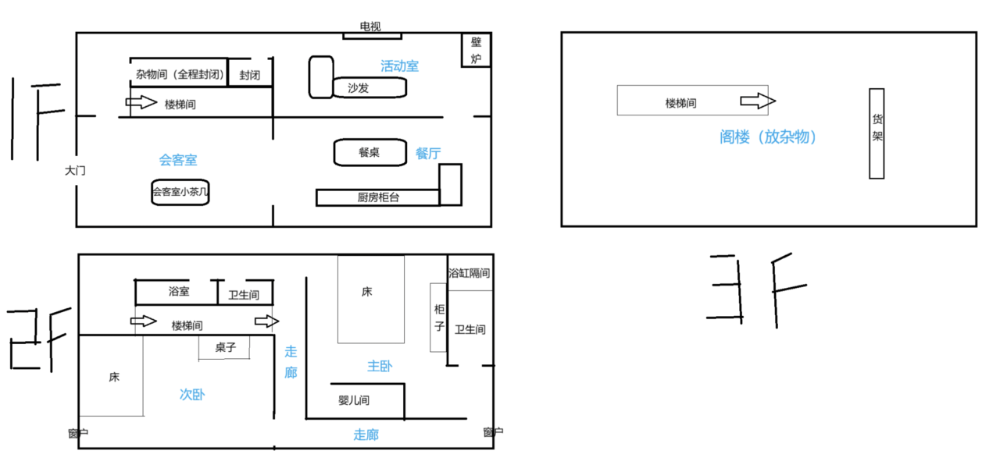

# 关卡设计

## B部分地图

1 给流程玩法服务，当关卡设计

一楼要保证可以打枪封门溜鬼，即空间够大且相互联通，没什么死路，且有门能把空间分隔开。（如果同时存在两个联通一二楼的楼梯的话，也可以把二楼也加入到这个空间循环里）

2 参考现实里美国房子

主要材质是木头，刷涂料。一楼联通的公共空间，C位要有一个壁炉。二楼是前期主空间，有至少两个卧室以及单独的卫浴，要注意主角屋子开门是一个长廊，能接到过堂风。三楼阁楼有只去一次的小杂物间，地下室不要了。主要锚点：壁炉必须在客厅C位，窗户是上下滑动开启的“上下推拉窗”，门把手是圆球或下压式机械锁。可以参考《招魂》和《潜伏2》的房屋设计。

## A部分高塔部分地图

整体类似于平台跳跃，要不断通过跳跃和爬梯子往高处去，要让角色有失误可能性(跳向高平台时失败掉到下面的平台)，但又要避免一下子掉到特别低的地方。整个无失误爬塔时长最好能有两分半左右。

设定上是一座废弃高塔，所以随便点设计就行，不要太注重是否符合现实。
