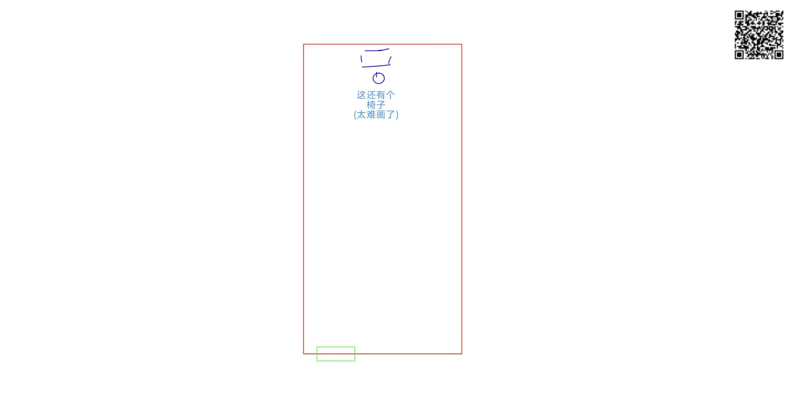
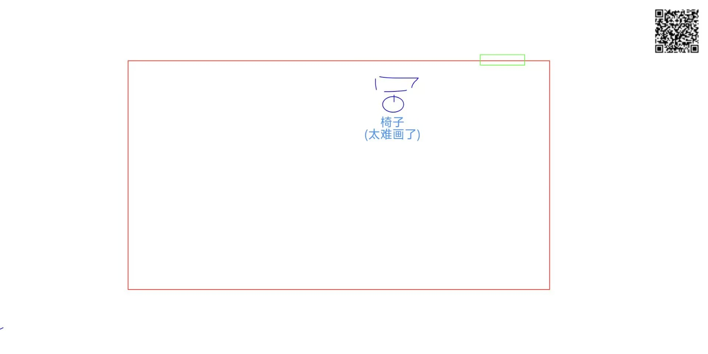
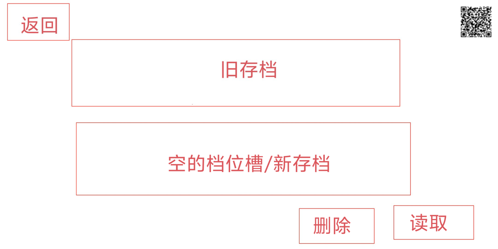
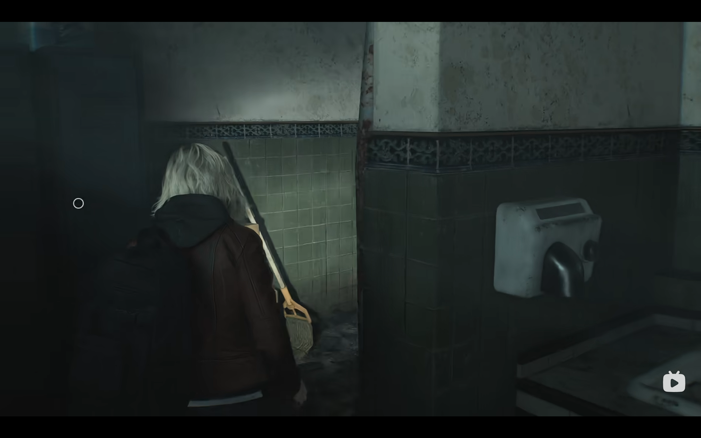
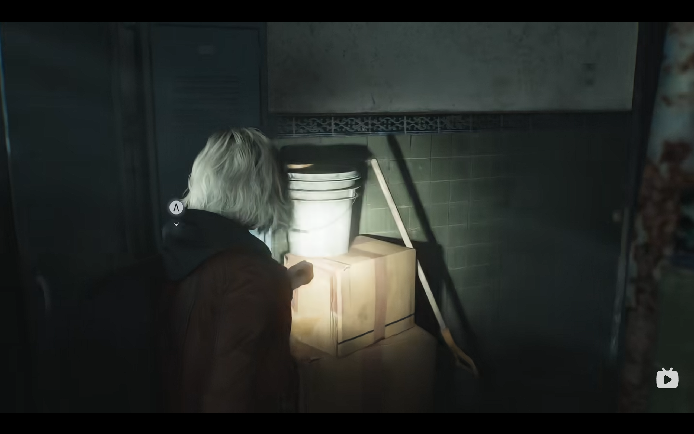
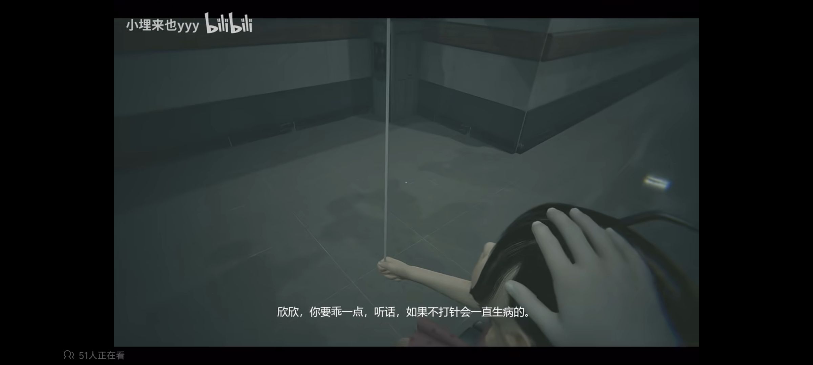

# 系统框架

# 整体结构

#### 整体是一个嵌套结构：

- 玩家主界面 *1*

  - 玩家玩的以B为主角的游戏内容 *2*

    - B玩的游戏的主界面 *3*

      - B玩的以A为主角的游戏内容 *4*

要注意的是，这不是一个完全等权承接下来的结构，*3*与*4*都可以直接与*2*进行切换，表现形式也就是在2状态下，随时可以拿出游戏机和收起游戏机，并且B在游戏机上玩游戏时，自己世界（*2*）的各种事务还是在进行的。到时候看看有没有实现难度问题或者实操起来的性能问题，有的话可以考虑略微改动框架偷点小懒

‍

## 拍门前置（实现起来有点麻烦的核心系统）

在游戏开始时，要求获取玩家与门的大致相对位置，我目前的打算是以完全俯视图的视角在屏幕上显示一个尺寸不能变化的玩家与电脑（90％的玩家应该都会用电脑玩这种游戏吧），放在一个长方形（模拟房间）里，长方形可以通过拽住四角来改变位置和比例，先锚定玩家与房间的尺寸位置关系，再给一个小长条作为门，可微调宽窄并必须附在墙壁的某个位置，让玩家锚定门与墙壁的位置和尺寸关系。最后根据电脑与座位的宽度（应该是50-60cm左右，我身边没尺子，你们可以测测），计算出门往外一点相对于玩家座位的位置变换，储存到一个变量里，后续某些桥段会根据这个向量变量播放发闷的连续拍门声（发闷是模仿戴耳机的情况下听拍门声的音色，这个音效交给弄音效的同学处理）

这个功能可能需要多次测试来微调算式才能实现略为精准的位置判断，但好消息是人一般在比较紧张且戴耳机判断能力模糊的情况下，来自那个大致方位的拍门声就会被直接怀疑成是拍门的声音

大致效果图

 

或

‍

## *1* ==玩家主界面==

#### 存档——

第一次打开游戏时，有一个旧存档和一个空档位。“返回”键随时可以点击并返回上一级，已经有存档的档位点击后会“选中”，此存档如按钮下陷，此时可以选择删除或读取。但在玩完全流程之前，旧存档选择后，删除与读取键会被禁用，要么是暗色无响应处理，要么是点完后红亮加禁止音效。而第一次进入游戏时，下面的档位是空档位，点击后会跳出新的一级UI提示“是否创建你的存档”“是”和“否”，选择“否”后返回，选择“是”后创建一个存档，接下来可以选择这个自己创建的存档进行“删除”或“读取”。

（到时候UI会进一步设计，删除键最好做一下弱化处理，比如暗色以及比读取键小，防止误触，且点击删除后会再次出现一个二级UI再次确认是或否，点读取的话就直接读取）

可以理解为其实就一个档位，上面那个旧存档基本是摆设，先不用管

#### 设置——

就是设置，具体内容以后再说

#### 退出游戏——

就是退出游戏

##### 从“玩家主界面”到下一层级“玩家玩的以B为主角的游戏内容”的唯一途径就是选择第二个存档后点击“读取”

‍

## *2* ==玩家玩的以B为主角的游戏内容==

### 运动系统

常规的3D第一人称，wsad移动和摄像头旋转，要有手，如果要手搓的话记得留一下移动（最大）速度变量和可以禁用移动的接口

### 交互系统

这块我做

### 特殊能力系统（暂定）

后期获得枪和符咒，1和2切换，然后已拿出的情况下再按对应键是切换成空手。枪就是枪，右瞄准（减小FOV），左射击，不瞄准也能射击，不用做换弹系统，因为压根没几发子弹。符咒在门边可以按F键贴在门上，使得门在一定时间内无法被敌人通过，同样是有限资源。

### 敌人系统

需要一个能追踪主角且在室内地形环境下知道寻路不会撞墙的敌人AI，基本就恐怖游戏常用的那种鬼AI，默认状态下不需要外观（网格体），所以是不是个pawn都行。

敌人AI需要的详细功能：

在室内地形环境下自动寻找最近路线追踪主角，

默认隐身（不可视或压根没网格体），

准备一个僵直事件，僵直期间无法移动，显露出类似人形的黑雾身体并不断抽搐（具体什么样到时候再说，但反正是要变得可视的）

被子弹打中后僵直数秒，僵直结束后瞬移到一个与主角有一定距离的地方

有脚步声，能正常和一些开了物理模拟的小物件（比如地上的皮球）发生碰撞

碰撞主角后“游戏结束”，类似于杀死主角

到时候会有一个能贴在门上持续一段时间的“符咒”道具，贴在门上后门会被视为无法通过（或者说视为墙体）。贴符时，若有符门在当前敌人追击主角的线路上，且敌人与门距离>=3米（这个数可能根据测试改动），更换路线；若有符门在当前敌人追击主角的线路上，且敌人与门距离<三米，敌人不改变路线，随后与有符门发生碰撞进入一秒僵直，在此位置发出类似触电的音效，拍门音效和怒吼音效，随后更换路线。当持续时间结束，符咒消失时，若有更近的新路线，敌人更换路线。

### 菜单系统

在此层级时（注意前面这五个字），ESC会进入菜单系统，其中包含

- 保存游戏——会自动让现在的信息覆盖玩家存档
- 退出游戏到主界面——顾名思义，从*2*退回到*1*
- 返回游戏（鼠标选中或再次按ESC都是）——顾名思义，留在*2*

### 存档系统

需要一个到时候打算动不动写进关卡蓝图里的“自动保存”功能

### UI系统

一个是比如说交互的UI，形如

中距离出现可交互提示

近距离出现具体按键

然后可能还有别的形式的UI，比如读报纸，但出现频率非常低，我完整脚本写出来要是需要再看怎么弄

### 玩游戏系统

按空格（暂定）键拿出游戏机玩游戏 （从*2*进入到*3或4*），注意，此时*2*的一切仍正常运行，再按收起游戏机（从*3或4*回到*2*），若处于*4则*收起游戏机时自动暂停*4*层面游戏，要留个接口方便有的桥段走脚本强行从*3或4*回到*2*

### 台词系统

准备两个HUD就行，都屏幕下方，一个字小点，一个字大点，可以随时被调取接口blit在对应位置数秒（留个可修改的持续时间变量和文本内容变量，还是整数据表什么的？我不太懂，刘宁决定吧）

如

### 死亡系统

雪花屏两秒，然后回到最近存档点

‍

## *3* ==B玩的游戏的主界面==

除了没有“退出游戏”，其他和*1*一模一样

‍

## *4* ==B玩的以A为主角的游戏内容==

### 运动系统

横板卷轴游戏，如《烟火》，AD左右走，W跳跃，S下蹲（这俩烟火没有就是了）

### 交互系统

E键，这块我做

### 菜单系统

类似*2*的菜单系统

在此层级时，ESC会进入菜单系统（即暂停游戏），其中包含

- 保存游戏——会自动让现在的信息覆盖玩家存档
- 退出游戏到主界面——顾名思义，从*2*退回到*1*
- 返回游戏（鼠标选中或再次按ESC都是）——顾名思义，留在*2*

### 存档系统

需要一个层级低于*2*的保存功能，也就是说A的游戏在某处死亡重来的话，B不会重来，B的游戏死亡重来，A部分的整体信息也会跟着回退

### UI系统

同*2*，中距离提示，近距离交代按键

预计还会出现一个类似读报纸的检视，等出完整脚本再说

### 以及按空格放下游戏机停止玩游戏这么个事，我在*2*提过了，就不再重复了

‍

‍

# 角色B按键绑定

WSAD——前后左右

ESC——在“游戏状态下”打开菜单，即只有*2*或*4*时可用，打开状态下再按继续游戏

E——交互

空格——*2*的情况下拿出游戏机使得可进入*3与4*状态（此时手持物品切换为游戏机），再按回到*2*

1——有枪后将手持物品切换为枪

2——有符咒后将手持物品切换为符咒

左键——有枪后射击

右键——有枪后瞄准

F键——有符咒后贴符

# 角色A按键绑定

AD——左右

ESC——打开菜单，打开状态下再按继续游戏

E——交互

空格——放下游戏机，会自动暂停游戏

‍

# 暂时搁置的部分，未来可考虑加花

恐怖程度选择、配音、跑步频率的调整、手柄兼容、一些真假故事线的雪花屏闪回
