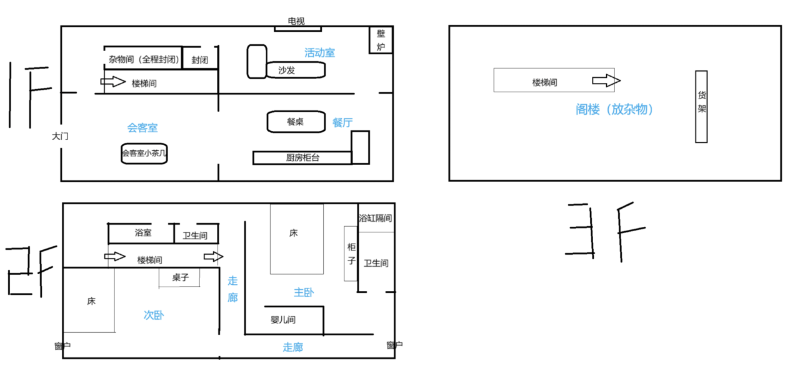
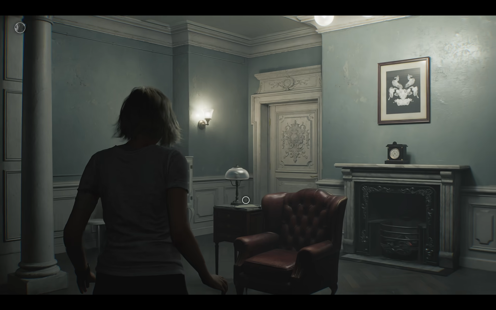
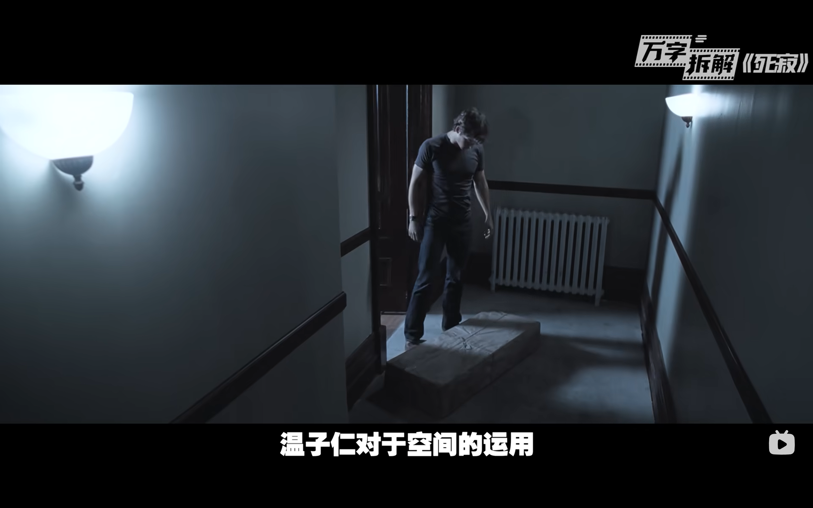

# 美术资源需求

# 美术资源需求

## UI图标

## 刚进入游戏要求电脑与门相对位置时的俯视图美术素材

## B游戏流程的3D资产

主要色调在黄昏阶段多使用暖黄（但不要太暖，可以降点饱和度），在入夜后使用暗色调，整体加一个偏灰蓝滤镜，显得阴暗，主色调为红蓝对比

具体资产你俩自己找吧（注意少用亮色，多用暗色，不过材质这块后补票也行）

至少包括：

小沙发

小茶几

大沙发

壁炉

厨房台

餐桌

电视

楼梯

护栏

多种门

床

桌子

柜子

浴室用品

卫生间用品

木架子

一些欧美常见杂物

上下开的窗户

钢制杯子

游戏机

枪

下面有个收信缝的大门

能出现在上面各个场景里的零散物件

‍

追加：

皮球（最好是多色的）

热水壶

厨房桌子要带水槽

装皮球的筐

唱片机

水杯（看起来不太易碎那种）

钥匙

‍

此外墙纸统一先用这两个颜色之间的质感（我估计这两张图基本是一个颜色的，即绿里发蓝，只是后者加了滤镜），重点找一下（材质），或者这个程度也可以试试自己调材质

‍

## A游戏流程的2D背景

以脏黄色为主色调，尽可能显得压抑

整体任务和背景关系的处理参考《烟火》

### 场景背景图

- 有点破败、沿途有好几个垃圾桶的美国街巷，比较长
- 学校食堂，背景里还有不少在吃饭的人影
- 学校更衣室
- A的家，中心是一个餐桌（这个不用画，到时候用模型，把位置留出来就行），整体比较破，背景有电动车，笔记本电脑，以及两个相框（一个是年轻夫妻，即A的父母，一个是十多年后的的父子，即A和父亲）
- 整座高塔的超长背景（可以偷懒重复拼接几次）
- 塔的顶部内外，具体来讲有一个不怎么长的延伸平台，里面风格还是塔，外边是星空和下面城市的光亮
- 地下室场景，比较有巫师地下室那种破败且带点邪性的感觉，色调脏黄一些
- 家门口的街道（美国贫困区街道，简而言之就是比中国农村宽敞一点，房子更大点），左上角的背景把那座高塔画上

### 插画图

- 一座高塔从地面向上仰视的“全身”图
- 从塔顶向下看城市的俯视图
